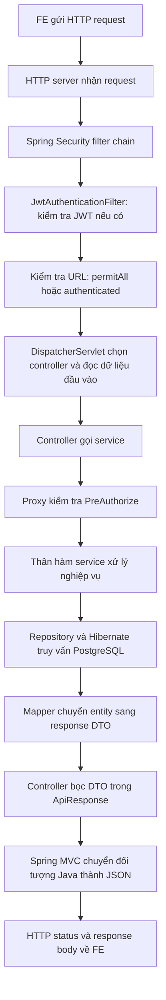

# Luồng request từ FE đến response

Tài liệu này mô tả code hiện tại. Hai ví dụ để lần theo là
`POST /api/auth/login` và `GET /users/findAll`.
Swagger UI cũng là một client gửi HTTP request giống FE.

## 1. Bắt đầu đọc code ở đâu?

`DatphongApplication.main()` chỉ khởi động Spring Boot, tạo các bean và HTTP server.
Hàm này không chạy lại mỗi khi FE gửi request.

Khi request đã đến backend, thứ tự tổng quát là:



Sơ đồ là đường đi thành công của API user, lược bớt các filter của framework.
JWT filter cũng truy vấn user để xác thực, trước lượt truy vấn nghiệp vụ của service.
Khi một bước từ chối request, các bước phía sau không chạy.

| Thứ tự đọc | File | Trách nhiệm |
|---|---|---|
| 1 | [SecurityConfig](../src/main/java/com/vn/datphong/config/SecurityConfig.java) | Cấu hình filter chain, URL công khai, yêu cầu đăng nhập và bật method security |
| 2 | [JwtAuthenticationFilter](../src/main/java/com/vn/datphong/security/JwtAuthenticationFilter.java) | Đọc Bearer token, kiểm tra token và tài khoản, đặt Authentication vào SecurityContext |
| 3 | [JwtTokenProvider](../src/main/java/com/vn/datphong/security/JwtTokenProvider.java) | Tạo JWT và đọc claims qua bộ xác minh chữ ký, hạn token |
| 4 | [CustomUserDetailsService](../src/main/java/com/vn/datphong/service/Impl/CustomUserDetailsService.java) | Đọc user, quyền và trạng thái hiện tại từ database cho Spring Security |
| 5 | [UserController](../src/main/java/com/vn/datphong/controller/UserController.java) | Nhận tham số HTTP, gọi service và tạo đối tượng response |
| 6 | [UserServiceImpl](../src/main/java/com/vn/datphong/service/Impl/UserServiceImpl.java) | Định nghĩa quyền bằng PreAuthorize và xử lý nghiệp vụ |
| 7 | [UserAuthorization](../src/main/java/com/vn/datphong/security/UserAuthorization.java) | Đối chiếu ID hồ sơ với username đã xác thực khi cần kiểm tra chính chủ |
| 8 | [UserRepository](../src/main/java/com/vn/datphong/repository/UserRepository.java) | Spring Data JPA tạo phần triển khai các truy vấn tới database |
| 9 | [UserMapper](../src/main/java/com/vn/datphong/mapper/UserMapper.java) | Chọn các trường entity được đưa sang UsersResponse |
| 10 | [ApiResponse](../src/main/java/com/vn/datphong/dto/response/ApiResponse.java) | Chứa success, message, data, error và timestamp |

`SecurityConfig` được tạo khi khởi động; không phải hàm xử lý từng request.
Code chạy trên từng request nằm trong các filter mà cấu hình này đăng ký.

## 2. Luồng đăng nhập: POST /api/auth/login

FE gửi JSON, không cần Bearer token cho lần đăng nhập đầu:

```http
POST /api/auth/login
Content-Type: application/json

{"username":"alice","password":"mat-khau-nguoi-dung-nhap"}
```

1. `JwtAuthenticationFilter` không thấy Bearer token nên gọi `filterChain.doFilter()`.
   Lệnh này chuyển request tới phần xử lý phía sau; không có nghĩa là bỏ kiểm tra bảo mật.
2. Quy tắc `permitAll()` trong `SecurityConfig` cho phép URL đăng nhập đi tiếp khi chưa xác thực.
3. Spring MVC chọn `AuthenticationController.login()`, chuyển JSON sang `LoginRequest`
   và kiểm tra các annotation validation do `@Valid` kích hoạt.
4. Controller gọi `AuthenticationService.login(request)`.
5. Service tạo `UsernamePasswordAuthenticationToken` chưa xác thực và gọi
   `AuthenticationManager.authenticate(...)`.
6. `DaoAuthenticationProvider` gọi `CustomUserDetailsService.loadUserByUsername()`.
   Repository tìm đúng username, rồi chuyển entity thành `UserDetails` gồm password hash,
   authorities, trạng thái enabled/locked. `UserDetails` dùng nội bộ, không trả về FE.
7. Provider kiểm tra trạng thái tài khoản và dùng `PasswordEncoder` kiểm tra mật khẩu.
   Mật khẩu lưu trong database cần tương thích với encoder đã cấu hình.
8. Khi xác thực thành công, service gọi `JwtTokenProvider.generateToken(authentication)`.
   JWT chứa username, authorities và hạn sử dụng; không chứa password hoặc secret 2FA.
9. Controller trả `ResponseEntity.ok(ApiResponse.customsuccess(...))` chứa `LoginResponse`.
   Spring chuyển thành JSON, HTTP 200. FE nhận `data.accessToken` và `data.tokenType`.

Các request tiếp theo cần gửi header `Authorization: Bearer <accessToken>`.
Backend đang dùng `STATELESS`: không dựa vào HTTP session để duy trì đăng nhập giữa các request.

Lưu ý theo code hiện tại: `permitAll()` không bỏ qua JWT filter. Nếu FE gửi một Bearer
token sai/hết hạn ngay cả tới URL login, filter vẫn có thể trả 401 trước controller.

## 3. Luồng gọi API: GET /users/findAll

```http
GET /users/findAll
Authorization: Bearer <accessToken>
```

1. `JwtAuthenticationFilter.doFilterInternal()` đọc header và tách token.
2. `JwtTokenProvider` xác minh chữ ký/hạn token và đọc username.
3. Filter gọi `CustomUserDetailsService` để lấy tài khoản và authorities hiện tại từ database.
   Tài khoản phải có `active = true`, `status = ACTIVE`; tài khoản bị xóa/khóa/vô hiệu hóa bị từ chối.
   Authorities được tải lại từ database, không lấy trực tiếp từ claim roles trong token.
4. Filter tạo Authentication đã xác thực, đặt vào `SecurityContextHolder`, rồi cho request đi tiếp.
   Context này cung cấp danh tính cho quá trình xử lý request, không phải response gửi FE.
5. Quy tắc URL `authenticated()` cho phép request đã xác thực đi vào Spring MVC.
6. `DispatcherServlet` chọn `UserController.findAll()` theo HTTP method và URL.
7. Controller gọi `userService.findAll()`. Spring đi qua proxy của service để kiểm tra
   `@PreAuthorize("hasAuthority('ROLE_ADMIN')")` trước khi chạy thân hàm.
   Đăng nhập thành công nhưng không có ROLE_ADMIN sẽ bị từ chối 403 tại đây.
8. Khi được phép, service gọi `userRepository.findAll()`. Spring Data JPA/Hibernate thực hiện
   truy vấn và chuyển các bản ghi database thành entity `User`.
9. `.stream().map(UserMapper::toResponse).toList()` chuyển từng entity thành `UsersResponse`.
   Đây là bước chọn dữ liệu được công bố: DTO không có `password` và `twoFactorSecret`.
10. Service trả danh sách DTO. Controller bọc danh sách bằng `ApiResponse.success(...)`.
11. Spring MVC dùng HTTP message converter/Jackson để serialize đối tượng Java thành JSON.
    FE nhận HTTP 200 và danh sách tại trường `data` trong JSON body.

Ví dụ cấu trúc response minh họa, không phải dữ liệu đọc từ database:

```json
{
  "success": true,
  "message": "Success",
  "data": [],
  "error": null,
  "timestamp": "2026-10-16T00:00:00Z"
}
```

`ApiResponse` là body, không tự quyết định HTTP status bằng trường `success`.
HTTP status do controller/ResponseEntity/framework/exception handler quyết định.

Ví dụ FE đọc response thành công bằng `fetch`, với `token` đã nhận khi login:

```javascript
const response = await fetch("http://localhost:8080/users/findAll", {
  headers: { Authorization: `Bearer ${token}` }
});
if (!response.ok) {
  throw new Error(`HTTP ${response.status}`);
}
const body = await response.json();
const users = body.data;
```

Nếu dùng Axios, `response.data` là toàn bộ JSON body; danh sách user nằm ở
`response.data.data` vì bên trong có thêm lớp bọc `ApiResponse`.

## 4. Xem và sửa hồ sơ cá nhân

`GET /users/detail/{id}` và `PUT /users/update/{id}` dùng điều kiện tại method service:

```java
@PreAuthorize("hasAuthority('ROLE_ADMIN') or @userAuthorization.isOwner(#id, authentication)")
```

- ADMIN được phép truy cập hồ sơ theo ID.
- Với tài khoản khác, `UserAuthorization.isOwner()` đối chiếu ID trên URL và
  `authentication.getName()` bằng `existsByIdAndUsername(...)`.
- Username dùng xác định chủ sở hữu lấy từ Authentication, không lấy từ JSON do FE gửi.
- Với PUT, Spring chuyển body sang `UsersResquest` và validation trước khi controller gọi service.
- Controller update hiện gọi `getById()` để kiểm tra tồn tại rồi mới gọi `update()`;
  cả hai lời gọi đều qua kiểm tra quyền ở service. Khi debug sẽ thấy lượt đọc hồ sơ trước lượt cập nhật.
- Chỉ sau khi được cấp quyền, service mới đọc và thay đổi entity. `@Transactional` ở `update()`
  cho phép Hibernate ghi các thay đổi của entity được quản lý khi transaction commit.
  Việc gán field trong Java không đồng nghĩa SQL đã commit ngay tại dòng đó.

## 5. Nếu request bị lỗi thì dừng ở đâu?

| Trường hợp | Nơi xử lý hiện tại | Kết quả chính |
|---|---|---|
| API cần đăng nhập nhưng không có token | Filter chain, AuthenticationEntryPoint trong SecurityConfig | HTTP 401, chưa vào controller |
| Token sai/hết hạn hoặc tài khoản đã khóa/vô hiệu hóa/bị xóa | JwtAuthenticationFilter | HTTP 401, chưa vào controller |
| Sai mật khẩu hoặc tài khoản không được phép đăng nhập | DaoAuthenticationProvider, rồi exception handler của MVC | HTTP 401, không tạo JWT mới |
| Đã đăng nhập nhưng thiếu quyền/chưa phải chính chủ | Proxy kiểm tra PreAuthorize, rồi GlobalExceptionHandler | HTTP 403, không chạy thân hàm service bị chặn |
| DTO không vượt qua validation | Spring MVC và exception handler | HTTP 400, không chạy thân hàm controller |
| User không tồn tại và người gọi có quyền kiểm tra | Service ném ResourceNotFoundExcept, exception handler của MVC xử lý | HTTP 404 |

Không phải mọi lỗi đều đi qua `GlobalExceptionHandler`. JWT filter và các handler trong
`SecurityConfig` gọi `response.sendError(...)`, nên body lỗi không được đảm bảo có dạng ApiResponse.
Với lỗi trong MVC, dự án hiện có cả `GlobalExceptionHandler` và `GlobalExeptionHander`
cùng xử lý một số loại exception; format body của các lỗi trùng handler chưa được thống nhất.
Tài liệu này ghi nhận hiện trạng, chưa thay đổi cơ chế xử lý lỗi.

## 6. Đặt breakpoint trong IntelliJ

Chạy `Debug DatphongApplication`, rồi gửi request từ FE/Swagger. Dùng F8 để đi qua dòng,
F7 để đi vào hàm, F9 để chạy tới breakpoint tiếp theo.

| Thứ tự | Đặt breakpoint tại | Cần quan sát |
|---|---|---|
| 1 | JwtAuthenticationFilter.doFilterInternal | URI, có Bearer token không, request có bị return sớm không |
| 2 | CustomUserDetailsService.loadUserByUsername | Đúng username, authorities và trạng thái tài khoản không |
| 3 | AuthenticationService.login (khi đăng nhập) | Kết quả authenticate, chỉ tạo JWT sau khi xác thực thành công |
| 4 | UserController.findAll | Request đã vượt qua kiểm tra ở filter chain |
| 5 | UserAuthorization.isOwner (khi xem/sửa hồ sơ bằng user thường) | ID trên URL có thuộc username đã xác thực không |
| 6 | UserServiceImpl.findAll hoặc update | Nếu thiếu quyền thì breakpoint trong thân hàm service không được chạm tới |
| 7 | UserMapper.toResponse | Entity đầu vào và các trường DTO đầu ra |
| 8 | ApiResponse.success/customsuccess hoặc GlobalExceptionHandler | Body thành công hoặc lỗi trước khi Spring serialize |

Không cần đặt breakpoint trong implementation của `UserRepository`: Spring Data tạo nó tự động.
Có thể đặt tại dòng gọi repository trong service và xem kết quả sau khi bước qua dòng đó.
Không đưa password, JWT hoặc secret 2FA vào log khi debug.

Tham khảo: [Spring Security Servlet Architecture](https://docs.spring.io/spring-security/reference/servlet/architecture.html).
